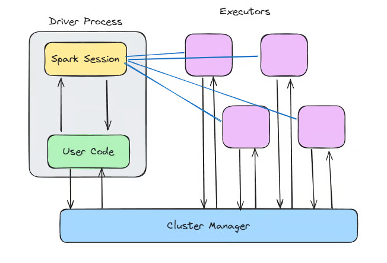
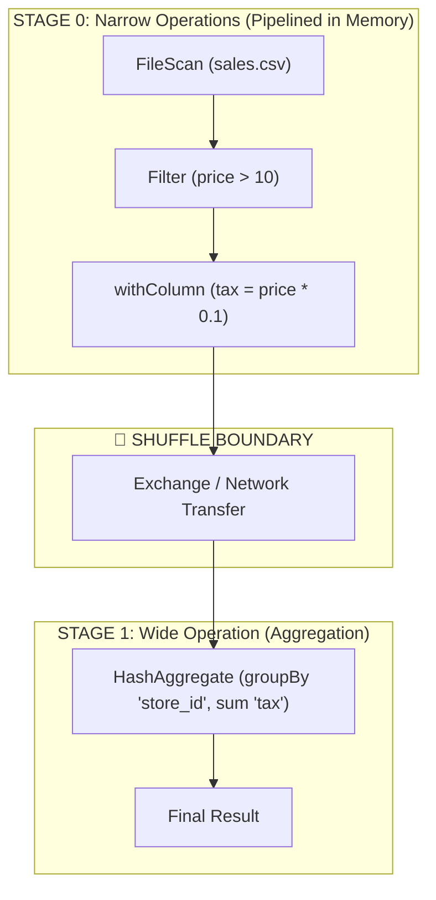

## key components of the spark architecture

### spark driver // the manager
==central controller of a spark app.== 
controls overall execution sending tasks to executors, monitors their process and ensuring their job is completed successfully. 

the controller creates a `SparkSession` to initialize a spark application and the session handles the communication with the cluster.

```python
from pyspark.sql import SparkSession
# init spark session driver
spark = SparkSession.builder.appName("some spark example").getOrCreate()
```

> in older versions of spark there was a spark context (remember this from uni) but the session now integrates the context and the sqlcontext.

### spark executors // the worker bee
==responsible for executing tasks assigned to them by the driver.==

they process data and send results back to the driver.

executors handle big chunks of the dataset in parallel.

### spark cluster manager // resource allocator
==responsible of efficient resource allocation.
it handles resource management across nodes in a cluster.==

spark has multiple options for resource management. a common one is YARN

#### YARN
*Yet Another Resource Allocator*

Cluster Manager that handles resource allocation across distributed systems. Widely used in hadoop-based ecosystems to manage resources effectively.
In the context of Spark, YARN allocates resources (memory, CPU) to spark applications, ensuring that jobs are run smoothly across the cluster.

two primary components:
1. **resource manager (RM)**: responsible for managing the resources across the cluster.
2. **node manager (NM)**: runs on each node in the cluster and monitors the resources on that node.
the RM schedules and allocates resources for spark applications while the NM keeps track of available resources on each node.

### Resilient Distributed Datasets (RDDs)
**spark's fundamental data structure**
==immutable collections of objects that can be distributed across a cluster==

RDDs can be created from data in storage (HDFS or S3) or from exiting RDDs through transformations.

RDDs are fault tolerant. If a node fails they can be recomputed using their lineage information.

```python
# df to rdd
rdd = df.rdd  
# transformation executed in parallel across the nodes in the cluser
rdd_filtered = rdd.filter(lambda x: x[1] > 30)
```

### DAG: execution graph
apache uses a **Directed Acyclic Graph** to represent the data processing workflow.

==a DAG represents the transformations an RDD goes through.==

#### how does it work?
when a user submits a spark application, the system constructs a DAG (stages + tasks).
then the DAG scheduler divides the DAG into stages, each containing multiple tasks that can be executed in parallel.
**this allows spark to optimize complex chains of operations and improve performance.**

 Each operation in your Spark job is represented as a node in the DAG, and the dependencies between operations are represented as edges.


spark divides operations into two types:
1. **narrow dependencies:** a worker can complete the op using only the data it got. each output partition depends at most on one input partition.
		`filter(), select(), withColumn(), map()`
	spark pipelines these together, it does not intermediately write results to disk, it executes them in one sweep. 
	**they all live in the same task and same stage.**
	
2. **wide dependencies / shuffles:** output partition depends on data from multiple inputs or partitions in different executors so data needs to be physically shuffled across partitions.
		`groupBy(), join(), distinct(), reduceByKey()`
	spark cannot process until data is shuffled so this is split into 2 stages.

take:
```python
df = spark.read.csv("sales.csv")
df_clean = df.filter(df.price > 10)                  # narrow operation
df_mod = df_clean.withColumn("tax", df.price * 0.1)  # narrow operation
df_grouped = df_mod.groupBy("store_id").sum("tax")   # wide operation (shuffle!)
```



### catalyst optimizer
mostly to optimize the execution of queries on datasets and dataframes.

 it analyzes the logical execution plan and applies optimizations like predicate pushdown, constant folding, and reordering of operations to improve query performance.

it is especially helpful when using built-in spark functions, as it can reorder and optimize transformations to avoid unnecessary computation.


### shuffle
==costly operation in which data is redistributed across partitions.==

**what causes it?** join, groupBy, repartition.
**why so expensive?** to run these ops, data needs to be transferred from their original nodes this can cause network congestion and I/0 issues.
## related
[[00_spark_basics]]