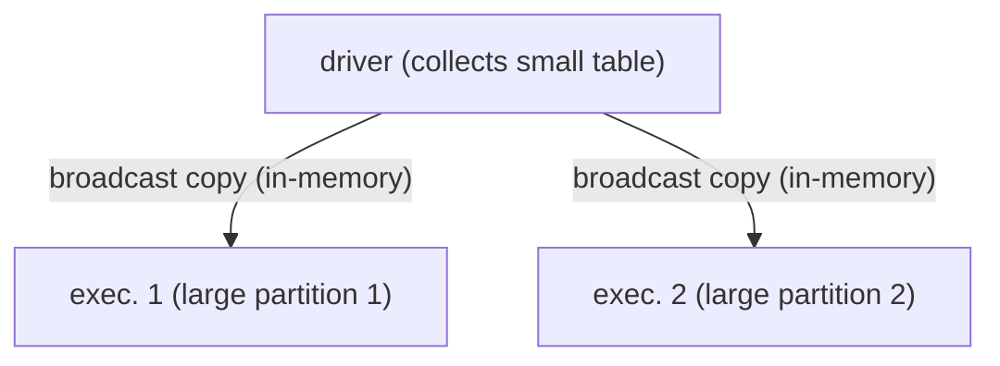
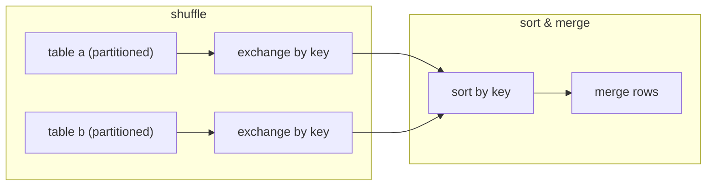
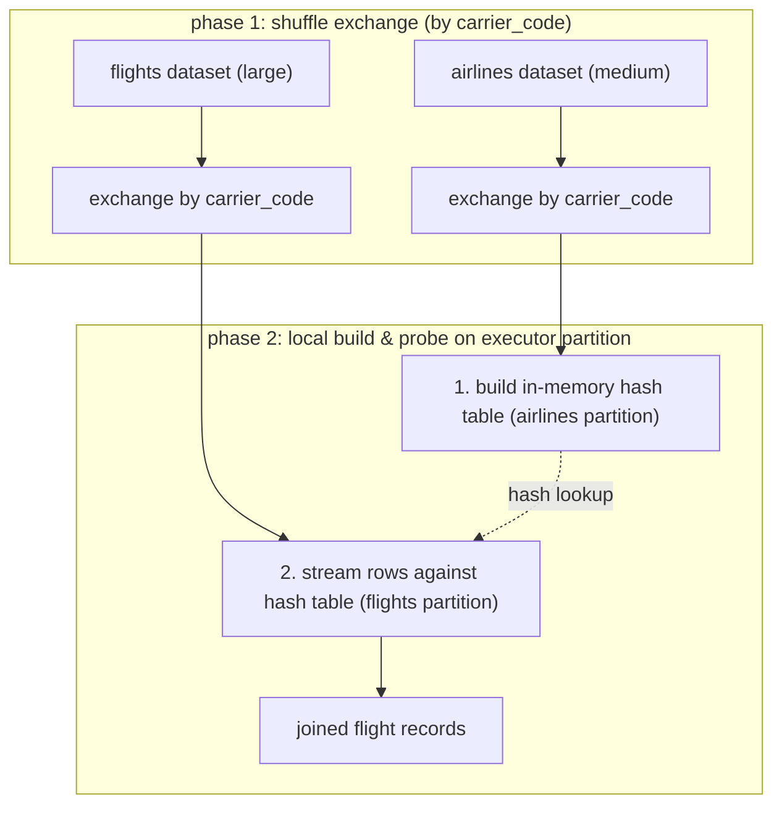
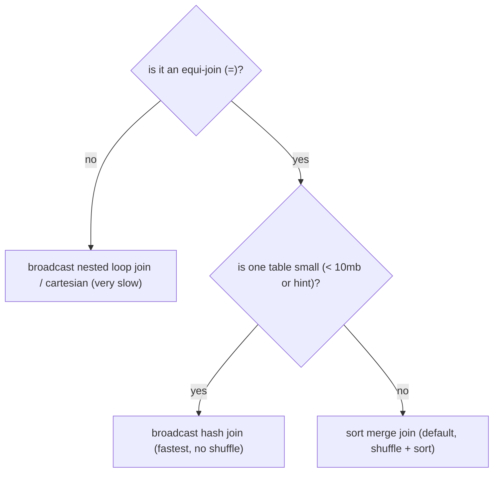

when joining two dataframes, Spark chooses an execution strategy based on:
1. dataset sizes
2. join condition (equality `=` vs non-equality `<`, `>`, `!=`)
3. join type: inner, left, outer, cross.

---

## 1. broadcast hash join (BHJ)
> the fastest join in spark → **zero shuffle on the big table**

```python
# automatically broadcast tables < 10MB
spark.conf.set("spark.sql.autoBroadcastJoinThreshold", "10MB")

# use hint to force broadcast
large_df.join(small_df.hint("BROADCAST"), "airline_code")
# or use programmatic API
from pyspark.sql.functions import broadcast
large_df.join(broadcast(small_df), "airline_code")
```
### how it works
1. the driver collects the smaller dataset.
2. the driver broadcasts a copy of the entire small dataset to all worker nodes/executors.
3. each executor loads the small table into an in-memory hash table and streams its local partition of the large table against it.



- **threshold:** triggered automatically if table size $\le$ `10 MB` (`spark.sql.autoBroadcastJoinThreshold`).
- **manual hint:**
  ```python
  from pyspark.sql.functions import broadcast
  df_joined = df_large.join(broadcast(df_small), on="airport_code", how="left")
  ```
- **pros:** blazing fast ← completely eliminates network shuffle of the large table.
- **cons / risk:** if the broadcasted table is too large, the driver crashes with `Driver OOM` or executors crash trying to deserialize it.

---

## 2. sort merge join (SMJ)
> spark's default join strategy for joining two large datasets that don't qualify for a broadcast

```python
df1.join(df2.hint("MERGE"), "airline_code") 
```
### how it works 
execution has 3 main phases:
1. **shuffle (exchange):** both datasets are hash-partitioned on the join key across the cluster so rows with identical keys land on the same node.
2. **sort:** each executor sorts rows locally within its partition by the join key. each side is sorted independently. **sort is expensive: O(n·log(n))**
3. **merge:** spark iterates through both sorted streams simultaneously, joining matching keys without keeping everything in RAM. Bc phase 2 sorts data, Spark can merge efficiently (linear time complexity per partition) by advancing pointers and no nested loops.



- **pros:** highly scalable, handles massive datasets because data can spill to disk if memory is insufficient. **bc of this considered to be the most stable join.**
- **cons:** expensive network shuffle and disk I/O due to sorting.

---

## 3. shuffle hash join (SHJ)
> used when tables are medium-sized and sorting is too expensive

```python
df1.join(df2.hint("SHUFFLE_HASH"), "airline_code") 
# prefer shuffle hash over sort-merge globally
spark.conf.set("spark.sql.join.preferSortMergeJoin", "false")
```
### how it works
1. **shuffle (exchange):** shuffles both datasets across the cluster by join key (e.g. `airline_code`).
2. **build:** instead of sorting, each executor builds an in-memory hash table for the smaller side's partition (e.g. `airlines`).
3. **probe:** the executor streams the larger side's partition (e.g. `flights`) against the hash table to find matches.



- **when to use:** one table is much smaller than the other, but still too large to broadcast (> 10 mb); saves the $O(n \log n)$ sort cost of Sort Merge Join as long as the build-side partition fits in executor memory.


## 4. broadcast nested loop join (BNLJ)
> the fallback of last resort

- used when joining on non-equality conditions (e.g. `df1.time >= df2.start_time AND df1.time <= df2.end_time`) or Cartesian products (`crossJoin`).
- compares every row of Table A with every row of Table B ($O(M \times N)$) → thus the *nested*
- **extremely slow.** in production, always try to rewrite non-equi joins into range/bucketed equi-joins if possible.


## decision tree for interviews



---

## related
- [[partitioning]]
- [[data skew]]
- [[00 spark architecture and topology]]
