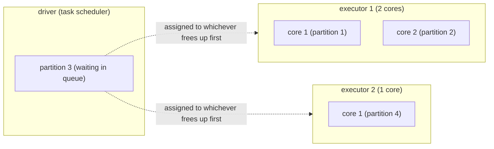

a partition is a chunk of data that spark can process in parallel to the rest of partitions

partitioning is how to efficiently divide the dataset in chunks.

- 1 partition is handled by 1 task by 1 executor
- more partitions means more tasks can run in parallel
- few partitions means the cluster may not be fully used (not everyone gets a partition to run)
- too many partitions might mean more time spent scheduling, shuffling and memory use.



#### advantages of partitioning
- **scalability**: horizontal scalability. if data grows, more partitions are added and more executors can be added.
- **improved performance:** parallel processing of the diff partitions by the diff. workers.
- **improved fault tolerance:** if data is distributed and a machine fails only that partition is lost instead of all data
- **data organization:** data partitions can be sliced by a meaningful aspect of the data 

### methods of partitioning

#### hash partitioning
> default method of partitioning in spark
> think `groupBy` ( `explain()` section in task 3 of [[airport_flight_operations]] )

a unique hash value is assigned to each record based on a column and then those with the same hash get placed in the same partition.

```python
df = df.repartition(4, "id")
```

#### range partitioning
> think `orderBy` ( `explain()` section in task 3 of [[airport_flight_operations]] )

dataset sliced in accordance to a range of values: the data gets sampled, a set of boundaries is extracted and the data ranges are calculated with the number of partitions and the boundaries
```python
df = df.repartitionByRange(4, "dates")
```
#### partitionBy
used to split data into smaller, more manageable partitions based on the values in one or more columns.

```python
data = [
    ("AA101", "American", "JFK", "LAX", "2026-11-01"),
    ("DL202", "Delta", "ATL", "ORD", "2026-11-01"),
    ("UA303", "United", "SFO", "JFK", "2026-11-02"),
    ("AA104", "American", "JFK", "MIA", "2026-12-05"),
]
columns = ["flight_id", "airline", "origin", "destiny", "date"]

df = spark.createDataFrame(data, columns)

# Extract year and month for cleaner, lower-cardinality partitions
df_partitioned = df.withColumn("year", year(col("flight_date"))).withColumn(
    "month", month(col("flight_date"))
)

(
    df_partitioned.write.mode("overwrite")
    .partitionBy("year", "month", "origin")
    .parquet("/data/flights_partitioned/")
)

```
produces

```markdown
/data/flights_partitioned/
├── year=2026/
│   ├── month=11/
│   │   ├── origin_airport=ATL/
│   │   │   └── part-00000.snappy.parquet
│   │   ├── origin_airport=JFK/
│   │   │   └── part-00001.snappy.parquet
│   │   └── origin_airport=SFO/
│   │       └── part-00002.snappy.parquet
│   └── month=12/
│       └── origin_airport=JFK/
│           └── part-00003.snappy.parquet
```


### coalesce vs repartition

when you want to change the number of partitions

> rule of thumb:
> 	- repartition for upscaling / balancing partitions
> 	- coalesce for downcaling / efficiency
#### `repartition`
- increases or decreases number of partitions
- **!!!!!** triggers a shuffle 
- ensures evenly balanced partitions

> **best when: upscaling partitions for parallelism or fixing skewed partitions**

#### `coalesce` 
- decreases number of partitions
- merges partitions to desired number → !!!! avoids shuflle
- faster and cheaper than repartition

> **best when: downscaling after filters/aggregations or optimizing output files before writting**


### related
- [[00_spark_basics]]****
- [[data skew]] → TODO, HOW IS PARTITIONING REALTED TO DATA SKEW?