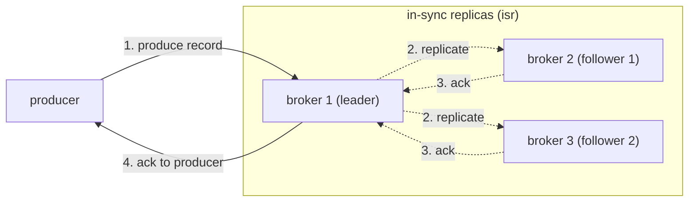
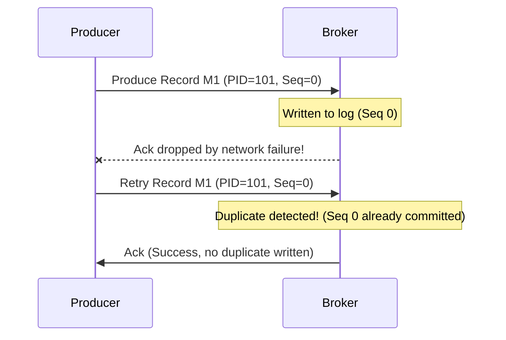

## 1. producer durability & acknowledgment (`acks`)

when a producer writes a message to a partition leader, `acks` determines when the write is considered successful.



### the three `acks` settings
> [!hint] remember:
>  latency (ms) = how long it takes for an event to go from the producer to the broker to the consumer (usually the lower the better  → less time) 
> throughput = how much data kafka can send, store and digest (MB/s or records per second)

| Setting               | Durability  | Latency / Throughput               | Data Loss Risk                                                                                                               |
| :-------------------- | :---------- | :--------------------------------- | :--------------------------------------------------------------------------------------------------------------------------- |
| **`acks=0`**          | None        | Highest throughput, lowest latency | **High.** Fire-and-forget; producer never waits for confirmation.                                                            |
| **`acks=1`**          | Medium      | Low latency                        | **Medium.** Leader writes to its local log and immediately acks. If leader crashes before followers replicate, data is lost. |
| **`acks=all` (`-1`)** | **Maximum** | Slightly higher latency            | **Near Zero** (when paired with `min.insync.replicas`). Leader waits until all in-sync replicas acknowledge.                 |


## 2. the critical pairing: `acks=all` + `min.insync.replicas`

> **interview trap:** does setting `acks=all` guarantee zero data loss on its own?  
> **No!** If `min.insync.replicas` is left at default (`1`), and all followers drop out of the ISR (In Sync Replicas), the leader can satisfy `acks=all` alone. If that single broker dies, messages are lost.

### production golden configuration
```properties
# topic level or cluster level
replication.factor=3
min.insync.replicas=2

# producer level
acks=all
```
- **how it works:** with RF=3 and `min.insync.replicas=2`, Kafka guarantees that at least 2 replicas (the leader + at least 1 follower) must acknowledge before the producer receives success.
- If 2 out of 3 brokers crash, only 1 replica remains in ISR. Writes will fail with `NotEnoughReplicasException`, preventing un-replicated data from being accepted.

## 3. the idempotent producer (`enable.idempotence=true`)

### the duplicate write problem (without idempotence)
1. Producer sends message $M_1$.
2. Broker writes $M_1$ to commit log.
3. Network connection drops before the broker's acknowledgment reaches the producer.
4. Producer assumes write failed and retries sending $M_1$.
5. Broker writes $M_1$ a second time $\rightarrow$ **duplicate record stored!**



### how idempotence fixes it
When `enable.idempotence=true` (default in Kafka $\ge 3.0$):
1. Broker assigns each producer a unique **Producer ID (PID)**.
2. Producer attaches a monotonically increasing **Sequence Number** (0, 1, 2...) to each batch per partition.
3. If the broker receives a record with a sequence number it has already committed for that PID, it acknowledges success to the producer but **discards the duplicate payload**.


## 4. end-to-end delivery semantics

| Semantics | How It Works | Trade-off | Typical Use Case |
| :--- | :--- | :--- | :--- |
| **at-most-once** | Commit offset **before** processing message. | Message loss on consumer crash, but never duplicates. | Non-critical metrics, telemetry where dropped points don't matter. |
| **at-least-once** | Process message **first**, commit offset **after**. | Zero message loss, but duplicates possible on crash. | **Industry standard default** for data engineering pipelines. |
| **exactly-once (EOS)** | Guaranteed processing exactly once end-to-end. | Requires transactional coordination or idempotent sink. | Financial transactions, critical flight booking / billing. |

### achieving exactly-once downstream (kafka $\rightarrow$ spark / database)
In real-world data engineering, achieving true EOS between Kafka and an external database/lakehouse is achieved via:

1. **At-least-once read from Kafka + Idempotent write to sink:**
   - Instead of standard inserts, use an **UPSERT / MERGE** on a deterministic natural key (e.g. `MERGE INTO delta_table USING source ON flight_id AND event_timestamp`).
   - If a crash occurs and Kafka re-delivers the batch, the merge cleanly overwrites identical records without creating duplicates.
2. **Spark Structured Streaming with Checkpoints + ACID Sinks:**
   - Spark Structured Streaming tracks Kafka offsets inside a durable checkpoint directory (ADLS / S3).
   - Writes to Delta Lake or Iceberg are transactional, ensuring state updates and offset commits occur together.


## 5. top production failure modes & remedies

### 1. consumer rebalance storms (`CommitFailedException`)
* **Cause:** Consumer's processing logic takes longer than `max.poll.interval.ms` (default: 5 minutes) to process a batch returned by `.poll()`.
* **Symptom:** Kafka coordinator assumes the consumer has died, removes it from the group, and triggers a full consumer group rebalance. When the consumer finally tries to commit, it throws `CommitFailedException`.
* **Remedy:**
  - Decrease `max.poll.records` (e.g. from 500 down to 50) so each batch is smaller.
  - Increase `max.poll.interval.ms` if heavy processing or external API calls are unavoidable.
  - Move heavy processing to a separate thread worker pool.

### 2. consumer lag
* **Definition:** The delta between the **Log End Offset (LEO)** (latest message written to partition) and the **Consumer Offset** (latest message committed by consumer).
* **Impact:** Downstream dashboards or analytics show stale data.
* **Remedy:**
  - Increase consumer parallelism (add consumer instances up to the number of partitions).
  - Increase partition count for the topic (note: partition count can only be increased, never decreased).

### 3. partition leader crash & unclean leader election
* **Scenario:** The broker hosting partition 0 leader crashes.
* **Normal Recovery:** Kafka promotes an In-Sync Replica (ISR) to become the new leader seamlessly.
* **Unclean Leader Election (`unclean.leader.election.enable`):**
  - If set to `true`: an out-of-sync follower can be promoted if all ISR replicas are down (prioritizes availability over consistency; causes message loss).
  - If set to `false` (production default): Kafka refuses writes until an in-sync replica recovers (prioritizes consistency over availability).


## related
- [[kafka fundamentals]]
- [[00_spark_basics]]
- [[salting hot keys]]
