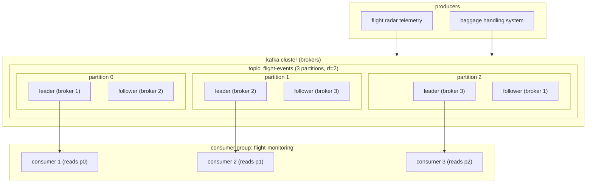
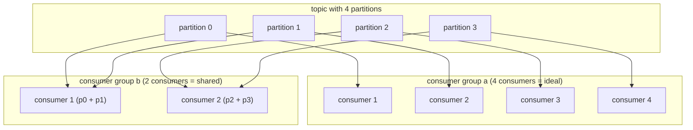

==Apache Kafka is a distributed event streaming platform used to capture, store, and move streams of data between applications and systems in real time== 

what that actually means:
- **distributed:** kafka works as a cluster of 1+ nodes that can live in different data centers. Data can be distributed across different nodes in the cluster, and it is inherently **scalable, available, and fault-tolerant.**
- **streaming platform:** kafka stores data as a stream of continuous records.
- **commit log:** when pushing to kafka, it takes the data passed and appends it to a stream of records.

**kafka is used for moving streams of data between systems.**
applications generate events (records) and they get written to kafka where other systems can read and process them.
**kafka captures streams of data, stores them so diff apps can process the data independently.**

**but kafka is commonly used for real-time streaming data pipelines,** *i.e. to transfer data between systems, building systems that transform continuously flowing data, and building event-driven systems*.

## 1. core architecture & topology
kafka architecture is designed to move large volumes of real-time data between applications, services, and data platforms. 
the architecture emphasizes **horizontal scalability, durability, and high throughput**.

in a kafka cluster:
- events are written to topics.
- topics are split into partitions and distributed across brokers.
- applications publish events into kafka and other systems consume them.
	- this decoupled design allows for teams to scale up and add new consumers and evolve without tightly coupling producers and consumers



### kafka data flow
1. a producer publishes an event to a topic.
2. the broker receives the event and writes it to the appropriate partition.
3. replicas copy the data across brokers.
4. consumers read events from the partition log.
5. applications process the events and update downstream systems.
### core components
- **producer:** publishes events.
- **broker:** a single Kafka server node that stores partitions and serves client requests. 
	each broker manages partitions of topics and handles communication with producers and consumers. 
	a kafka cluster is a collection of brokers coordinated via KRaft (Kafka Raft metadata mode) or legacy ZooKeeper.
- **topic:** a logical category or feed name to which records are published (e.g. `flight-events`, `passenger-checkins`).
- **partition:** the physical unit of scalability and parallelism. A topic is split into 1 or more partitions distributed across brokers.
- **consumer:** app the reads events from topics. they subscribe to one or more topics and process events as they are received. consumers keep track of their position in the log using offsets (fault-tolerance).
- **consumer group:** mechanism that allows multiple consumers to process partitions in parallel. 
	**within a group, only a consumer at a time can process from a partition!!**
- **segment:** partitions are stored on disk as a series of segment files (`.log` data file + `.index` offset-to-physical-position index). Once a segment reaches `segment.bytes` (default 1GB) or `segment.ms`, it closes and a new active segment opens.
- **replication factor (RF):** number of copies of each partition across distinct brokers. An RF of 3 means 1 leader replica and 2 follower replicas.

### producers
producers do not publish events over the network one by one. 
they send an internal record accumulator buffer and send messages in batches.
### consumers


## 2. anatomy of a kafka record

each record published to a partition contains:
```
┌────────────────────────────────────────────────────────┐
│ Record                                                 │
├──────────────┬─────────────────────────────────────────┤
│ Key          │ (optional) byte array used for routing  │
│ Value        │ payload (JSON, Avro, Protobuf, bytes)   │
│ Timestamp    │ event time (CreateTime) or LogAppendTime│
│ Offset       │ 64-bit integer monotonically            |
|              | assigned by the broker                  │
│ Headers      │ key-value metadata (tracing IDs, etc.)  │
└──────────────┴─────────────────────────────────────────┘
```


## 3. message keys, partitioning & ordering

> **fundamental rule:** Kafka guarantees strict chronological order **only within a single partition**, never across different partitions of the same topic.

### how partition routing works
1. **with a key:**
   $$\text{partition} = \text{murmur2}(\text{key}) \pmod{\text{num\_partitions}}$$
   all records sharing the exact same key always land on the exact same partition in the exact order they were produced.
2. **without a key (`null` key):**
   - In modern Kafka ($\ge 2.4$), uses the **Uniform Sticky Partitioner**: batches records together into the same partition until a batch fills up, then rotates to another partition. Maximizes network batching and throughput while distributing evenly.

### choosing the partition key
*for this subsection, we'll pretend we are working with flight/airport data*
*Event:* Flight status lifecycle (`SCHEDULED` $\rightarrow$ `BOARDING` $\rightarrow$ `AIRBORNE` $\rightarrow$ `LANDED`).

| Candidate Key | Pros | Cons / Risks |
| :--- | :--- | :--- |
| `flight_id` (e.g. `"IB3401"`) | **strict ordering** per flight; updates never race out of sequence. Evenly distributed. | **recommended.** |
| `origin_airport` (e.g. `"MAD"`) | All departures for an airport land together. | **severe partition skew.** Hub airports (`MAD`, `LHR`) produce 50x more messages than regional airports, creating hot brokers and lag. |
| `null` (round-robin) | Perfect load distribution across partitions. | **no ordering guarantee.** A downstream consumer might process `LANDED` before `BOARDING`. |


## 4. why is kafka so fast? (storage engine internals)

Kafka writes every message to **disk**, yet achieves millions of ops/sec. How?

### 1. sequential disk I/O
random disk access is slow (especially on HDDs and even NVMe SSDs due to seek overhead).

Kafka only does **sequential appends** to the end of the active segment file. Sequential write speed on modern disks approaches sequential memory bandwidth.

### 2. OS pagecache over JVM heap
- instead of maintaining large caches inside the JVM heap (which causes massive Java Garbage Collection pauses), Kafka leaves caching to the Linux OS **PageCache**.
- unused OS RAM automatically caches partition log segments. If Kafka restarts, the cache remains hot because it lives in the OS kernel space, not the process memory.

### 3. zero-copy data transfer (`sendfile`)
- standard network file transfer:
  $$\text{Disk} \xrightarrow{(1)} \text{OS Cache} \xrightarrow{(2)} \text{JVM User Space} \xrightarrow{(3)} \text{Socket Buffer} \xrightarrow{(4)} \text{NIC}$$
  *(requires 4 context switches and 3 data copies).*
- **Kafka zero-copy:** uses the Linux `sendfile()` system call:
  $$\text{Disk} \xrightarrow{(1)} \text{OS PageCache} \xrightarrow{(2)} \text{NIC Buffer}$$
  *(bypasses JVM memory entirely; data moves directly from kernel page cache to network card).*

## 5. consumer groups & scaling

a **Consumer Group** represents a coordinated set of consumers cooperating to consume a events from a topic in parallel.



### golden rules of consumer groups
1. **1 partition is consumed by at most 1 consumer instance per group at any given time.**
2. **max active consumers:** if a topic has 4 partitions and you deploy 6 consumers in the same group, **2 consumers will sit idle**.
3. **pub/sub vs queue:**
   - Multiple consumers in the **same group** = load-balanced worker queue (work is split).
   - Consumers in **different groups** = broadcast publish/subscribe (each group reads all messages independently).

### offset management
- consumers track their read progress via an **offset** (the sequence number of the next message to read).
- offsets are committed back to Kafka into an internal, compacted system topic: `__consumer_offsets`.

### the rebalancing process
if the number of consumers in a group changes, the assignment in partitions is rebalanced.

for example, if we have a baseline group of 4 consumers and 6 partitions where each of the consumers get 1 partition and 2 of them get assigned a second one:
- and 2 new consumers are added to the group, the partitions would be rebalanced for the consumers with 2 partitions to have a single one and the new consumers to get one each.
- and a consumer drops, the partitions would be rebalanced for the partitions that no longer have a consumer to be assigned to other consumers in the CG.
- and a partition is added to the topic assigned to the CG, the partition would be assigned to one of the consumers **depending on the assignor strategy.**

during the rebalancing process:
- ***eager rebalance (legacy):*** all consumers stop processing, release their partitions and wait for new assignments. this causes a processing pause that can impact latency-sensitive applications.
	- in order for consumers to know where to start consuming after the rebalance, this process happens:
		1. **state preservation:** before or during the pause, active consumers ensure their latest processed offsets are committed.
		2. **re-assignment:** the group coordinator assigns partitions to the available consumers.
		3. **offset fetching:** once a consumer is assigned a partition, it sends a request to Kafka to fetch the **last committed offset** for that specific partition from the `__consumer_offsets` topic.
		4. **resumption:** The consumer initializes its fetch position to that committed offset (plus one) and resumes pulling messages from the broker.
- ***cooperative sticky rebalance (modern protocols)*** reduce this impact significantly. instead of stopping all consumers, only the partitions being reassigned are revoked. consumers not affected by the change continue processing without interruption. 
	- ex.: cooperative rebalancing aka incremental cooperative rebalancing


## related
- [[delivery_guarantees_and_failure_modes]]
- [[00_spark_basics]]
- [[data skew]]
