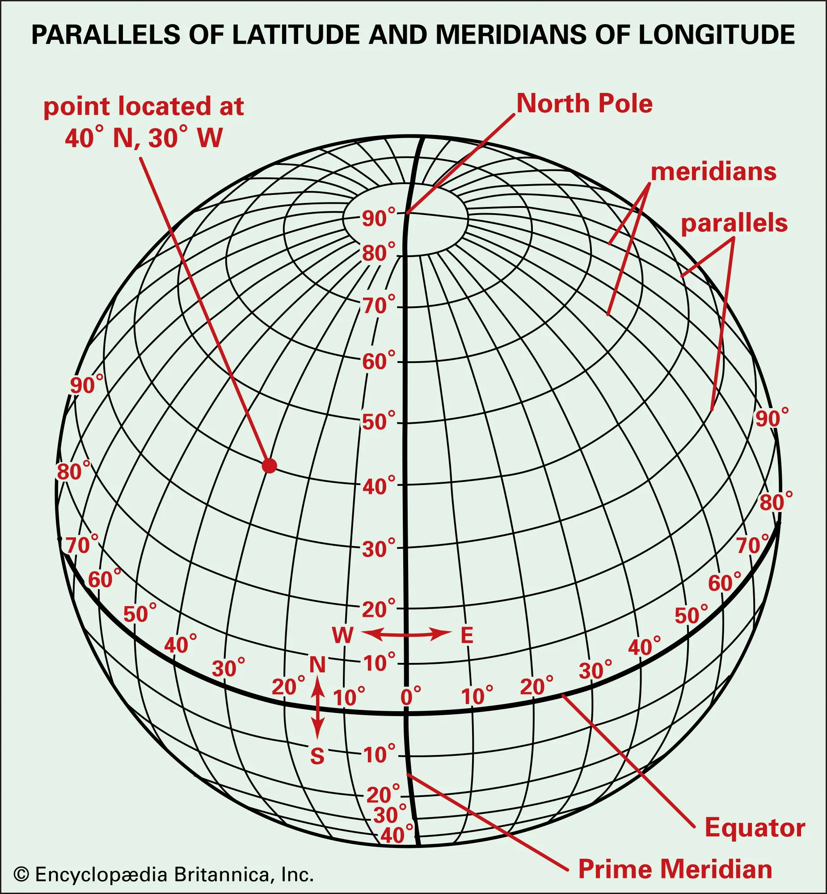

==CRS defines how a 2 dimensional map projects real places on earth.==

### the basic idea
the earth is a 3d spherical (ellipsoidal) object but maps are the 2d representation of said 3d object.
there are different approaches to how to translate an earth's  location in its curved surface to its 2d representation (on paper).

the earth is not flat so trying to represent it in a flat surface always entails some distortion

a CRS bridges the gap between the different dimensional formats using a combination of datum (earth model), map projection and a coordinate grid (ellipsoidal vs geoidal).

## crs = projection + datum + coordinate system 
 - **projection:** how curved earth's coordinates are flattened onto a map (Mercator, UTM, Lambert...). *How is the earth's shape flattened?*
 - **datum:** the reference model of Earth used for positioning (WGS84, GDA2020...). *Where is the shape pinned/anchored to the earth?*
 - **coordinate system/vertical reference:** whether height is measured on an ellipsoid (smooth math based surface) or a geoid (models sea level variations). *What shape is the earth?*

*from a set of coordinates a CRS will tell GIS how to interpret those numbers*

### coordinates
- **latitude/longitud:** angles (degrees) from the equator (north/south) and prime meridian. DMS vs decimal
- **easting/northing:** distances in meters from a false origin in a projected CRS.

> **!!!! axis order trap:** *EPSG:4326 officially says lat, lon, but most software (geojson, shapely, postgis) uses x=lon, y=lat. swapped coordinates are a classic bug.*



### projections
> mathematical transformation that flattens the earth into 2d.
> **distortion (angular, distance or area) is unavoidable. you have choose what to preserve depending on the focus of your analysis.**

#### projections by surface
different projections are obtained by surrounding the globe in a cylindrical fashion, a cone or a flat surface (azimuthal). each of these, produce a **map projection family**.
as a rough rule:
- planar projection: good for polar regions or around a point.
- conic projection: good for mid-latitude areas EW.
- cylindrical projection: good for near the equator or narrow NS strips.

#### projections by conformity
the choice in projection depends on the focus of the study. nothing preserves all of them at once.
if we need:
- **angular conformity:** these are called **_conformal_** projections. they preserve shapes/angular relationships. The larger the area, the harder it is for angular conformity to be kept (keep it small). 
	- **Good for navigation**.
	- **results in area distortion.**
	- Examples: *Mercator, UTM, Lambert Conformal Conic.*
	
- **_equal-area_** (areas): in these projections all mapped areas have the same proportional relationship to the areas on the earth that they represent. the larger the area analyzed the more precise the calculations will be.
	- **results in angular distortion.**
	- **good for when the focus revolves around calculations of an area.**
	- Examples: *Albers, Mollweide*
	
- _equidistant_ (distances from some point/line): a map is equidistant when it correctly represents the distance between the center of the map to any other place on it. **They require that the scale of the map remains constant.**
	-  Example: *Azimuthal Equidistant*, *Plate Carree Equidistant Cylindrical*, *Equirectangular projection*

- **UTM/MGA:** 60 zones, each 6° wide, keeps distortion small within a zone. MGA is UTM on GDA.
- **Web Mercator (EPSG:3857):** what web maps use, great for display, bad for measuring (Greenland looks the size of Africa).
### datum
>  mathematical model that defines the shape and size of the Earth’s surface, as well as the location of a reference point (the geodetic origin) and the orientation of the axes.

#### vertical datum
defines elevation (using a reference surface against which all is measured).

#### horizontal or geodetic datum
defines positions in terms of latitude and longitude. 

they have 2 parts:
1. **An ellipsoid**: the mathematical shape. A sphere squashed at the poles, defined by just two numbers: the equatorial radius (semi-major axis, ~6,378 km) and the flattening (~1/298). 
	1. Examples: *GRS80, WGS84 ellipsoid, Clarke 1866, ANS.*
2. **How that ellipsoid is pinned to the Earth**: where its centre is, how its axes are oriented, and (for modern datums) **at what date** (the reference epoch).

So: **datum = shape + placement (+ time)**. Two datums can share the exact same ellipsoid and still give different coordinates for the same spot, because they placed it differently.

> **reminder:** plates move!!!

## main types of crs
there are two main types of CRS:
1. **geographic coordinate systems**: use angular units like degrees (*WGS84*)
2. **projected coordinate systems:** they convert the Earth's surface to a flat map using meters or feet (*UTM, MGA...*)

## how to pick a CRS
the decision of which map projection to pick and which CRS depends on the regional extent of the area of work, the data used and its availability.

1. does your data already come in a specific CRS?
2. purpose of the data:
	1. display → whatever the map uses
	2. measure distance/area → projected CRS in meters suited to the area (**never degrees**)
	3. area statistics → equal-area
3. how big the area is:
	1. city/province/state → local UTM/MGA
	2. country/continent → national conic/equal area
	3. global → keep in 4326 or a global equal area projection
4. any local standards?
5. before you overlay/intersect, are all your layers in the same CRS?
	```python
	import geopandas as gpd
	rom shapely.geometry import Point
	d = {
		'col1': ['name1', 'name2'],
		'geometry': [Point(1, 2), Point(2, 1)]}

	data1 = gpd.GeoDataFrame(d, crs=4326)
	crs1 = data1.crs
	data2 = gpd.read_file(...)
	data2.to_crs(crs1)
	```